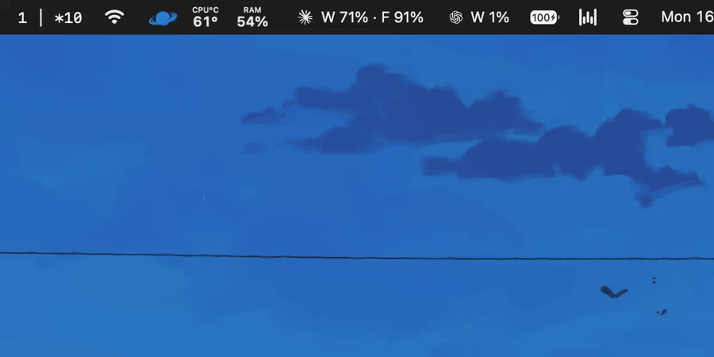

# token-hungry

Yet another token usage bar. There are many like it, but this one is mine.



See your remaining usage at a quick glance in your macOS menu bar. It's built on [SwiftBar](https://github.com/swiftbar/SwiftBar), and there's one Python file for each provider with no other dependencies.

## Two modes

Normal mode is for people with a job.

If you want to have fun, turn on Minecraft mode. You will see your Claude usage drain your hearts while ChatGPT drains your hunger. You can also see your banked resets by clicking on the menu bar. When you're down to a heart and you have no more resets left, stop prompting and touch some grass.

## Install

You need macOS and `python3`, plus [Claude Code](https://claude.com/claude-code) or [Codex](https://developers.openai.com/codex) signed in (either one, or both).

Paste this into your agent:

```
Install https://github.com/alexander-posztos/token-hungry by following the install steps in its README.
```

Or do it by hand:

```sh
brew install --cask swiftbar   # then open it once and pick a plugin folder
git clone https://github.com/alexander-posztos/token-hungry
ln -s "$PWD"/token-hungry/*.5m.py "$(defaults read com.ameba.SwiftBar PluginDirectory)"
```

The first time, macOS asks whether `security` may read Claude Code's login from the Keychain. Choose Always Allow.

Minecraft mode uses the [Monocraft](https://github.com/IdreesInc/Monocraft) font if you have it (`brew install --cask font-monocraft`).

## Fine print

It reads the login Claude Code and Codex already keep on your Mac and sends it only to Anthropic and OpenAI. Unofficial, and not affiliated with Anthropic, OpenAI or Mojang, whose sprites are in `sprites/`. The endpoints are undocumented and can change whenever they like.

If you want cost tracking, more providers or a real app, use [CodexBar](https://github.com/steipete/CodexBar).

[MIT](LICENSE)
